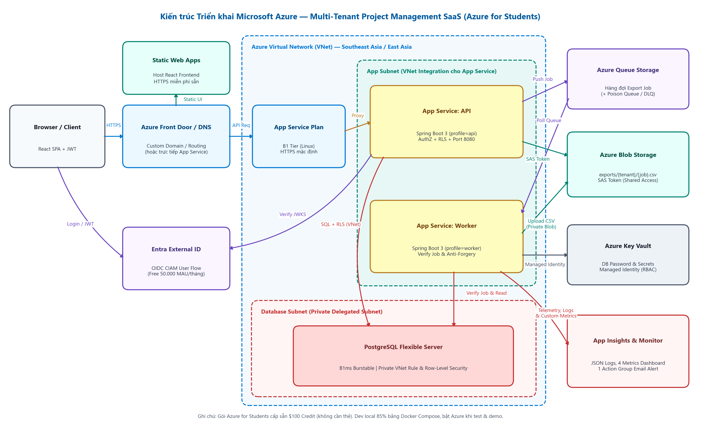

# Multi-Tenant Project Management SaaS — Final Project 06 (Advanced)

Hệ thống SaaS quản lý dự án và công việc đa tổ chức (**Multi-Tenant**) triển khai trên **Microsoft Azure**, đảm bảo cô lập dữ liệu tuyệt đối giữa các tổ chức từ tầng API, PostgreSQL Row-Level Security (RLS), Private Blob Storage, Background Queue Worker cho đến Logs và Monitoring.

---

## 1. Kiến trúc & Cấu trúc Mã nguồn (4 Thành viên)



| Thành viên | Vai trò & Phạm vi | Thư mục / Tài liệu chính |
| :--- | :--- | :--- |
| **Thành viên 1 (TV1)** | **Cloud Infrastructure, Network, Terraform IaC & CI/CD** | • Hạ tầng Terraform (32 Azure resources): [`infra/`](infra/)<br>• CI/CD & Rollback Workflows: [`.github/workflows/`](.github/workflows/)<br>• Báo cáo Chi phí & Cleanup: [`docs/tv1/COST_ESTIMATE_AND_CLEANUP.md`](docs/tv1/COST_ESTIMATE_AND_CLEANUP.md)<br>• Báo cáo Kiến trúc & Ranh giới bảo mật: [`docs/tv1/ARCHITECTURE_AND_SECURITY_BOUNDARIES.md`](docs/tv1/ARCHITECTURE_AND_SECURITY_BOUNDARIES.md)<br>• Hướng dẫn OIDC GitHub ↔ Azure: [`docs/tv1/GITHUB_OIDC_SETUP.md`](docs/tv1/GITHUB_OIDC_SETUP.md) |
| **Thành viên 2 (TV2)** | **Backend Core API, Multi-Tenancy Security & Database (RLS)** | • Mã nguồn Spring Boot 3 (Java 21) & Flyway SQL (`V1`, `V2__enable_rls.sql`, `V3__create_tasks_table.sql`, `R__seed_data.sql`): [`backend-core-api/`](backend-core-api/)<br>• Tài liệu Data Model, Security, Scaling: [`backend-core-api/docs/`](backend-core-api/docs/)<br>• Báo cáo & Slide TV2: [`Bao_cao_Thanh_vien_2_Backend_Core_API.docx`](Bao_cao_Thanh_vien_2_Backend_Core_API.docx) |
| **Thành viên 3 (TV3)** | **Async Export Worker, Observability & Load Testing (`k6`)** | • Mã nguồn Export Worker & Azure Queue Poller: [`prototypes/tv3-worker/`](prototypes/tv3-worker/)<br>• Báo cáo tổng kết & Kiểm thử (17/17 JUnit, 5/5 Prototype, `k6` p95 = 69.25 ms): [`docs/tv3/final-report.md`](docs/tv3/final-report.md), [`docs/tv3/test-report.md`](docs/tv3/test-report.md), [`docs/tv3/k6-summary.json`](docs/tv3/k6-summary.json)<br>• Azure Monitor Workbook (4 biểu đồ): [`prototypes/tv3-worker/observability/workbook.json`](prototypes/tv3-worker/observability/workbook.json) |
| **Thành viên 4 (TV4)** | **Frontend Web App (React), Automated Security QA & Design Report** | • Giao diện React + Vite + TypeScript: [`frontend/`](frontend/)<br>• Bộ kiểm thử bảo mật tự động (Tests 1–3, 36 cases, 6/6 scenarios): [`tests/security/`](tests/security/)<br>• Báo cáo thiết kế, Kịch bản Demo 10–15 phút & Trạng thái bàn giao: [`docs/tv4/DESIGN_REPORT.ipynb`](docs/tv4/DESIGN_REPORT.ipynb), [`docs/tv4/DEMO_SCRIPT.ipynb`](docs/tv4/DEMO_SCRIPT.ipynb), [`docs/tv4/STATUS_AND_HANDOFF.ipynb`](docs/tv4/STATUS_AND_HANDOFF.ipynb) |

---

## 2. Kiểm chứng Nhanh Toàn Bộ Hệ Thống (Local Verification)

### 2.1. Kiểm tra Hạ tầng Terraform (TV1)
```powershell
cd infra
terraform init -backend=false
terraform fmt -check
terraform validate
```

### 2.2. Kiểm tra Export Worker Security Prototype (TV3 — 5/5 cases)
```powershell
powershell -ExecutionPolicy Bypass -File prototypes/tv3-worker/scripts/run-tests.ps1
```

### 2.3. Kiểm tra Automated API Security Tests 1–3 & Quét Bí Mật (TV4 — 6/6 scenarios, 36 tests)
```powershell
pip install -r tests/security/requirements.txt
python tests/security/selfcheck.py
python tests/security/scan_secrets.py frontend tests docs infra
```

### 2.4. Build Backend API (TV2) & Frontend React (TV4)
```powershell
# Backend Core API & Worker (Maven + JDK 21)
cd backend-core-api && mvn test
cd ../prototypes/tv3-worker && mvn test

# Frontend SPA (Node.js 20+)
cd ../../frontend && npm ci && npm run build
```
